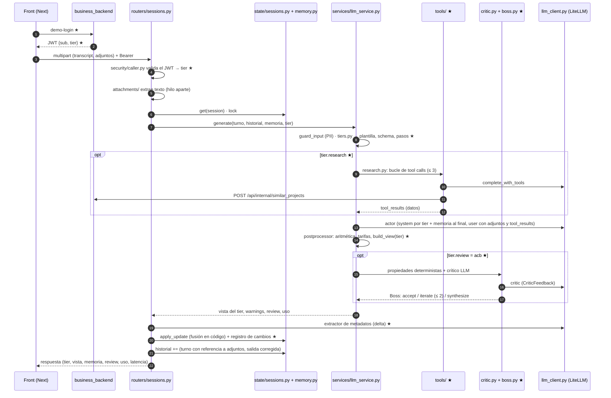

# Arquitectura de un turno de sesión

> **Estado: objetivo de la sesión 5.** Describe el turno tal como queda al
> terminar [el plan](plan-session-5.md). Hasta entonces, las piezas marcadas
> con ★ todavía no existen. En el paso 10 este documento pasa a describir lo
> construido.

## Recorrido de `POST /sessions/{id}/estimate`

## Dónde vive cada responsabilidad

| Capa | Archivo | Decide | No hace |
|---|---|---|---|
| HTTP | `app/routers/sessions.py` | Forma de la petición y la respuesta, orden del turno | Prompt ni llamadas al modelo |
| Identidad ★ | `app/security/caller.py` | Quién llama y con qué tier | Leer el tier del cuerpo |
| Perfil ★ | `app/tiers.py` | Plantilla, schemas, herramientas y revisión por tier | Lógica de negocio |
| Estado | `app/state/sessions.py`, `app/state/memory.py` ★ | Historial, memoria, fusión, olvido | Llamar al modelo |
| Orquestación | `app/services/llm_service.py`, `review_loop.py` ★ | Pasos del turno, cachés, presupuesto | HTTP |
| Herramientas ★ | `app/tools/`, `app/services/research.py` | Qué herramienta se ejecuta y cómo | Acceder a la BBDD del negocio |
| Revisión ★ | `app/services/critic.py`, `app/services/boss.py` | Issues estructurados; aceptar, iterar o sintetizar | Reescribir la estimación |
| Validación | `app/services/postprocessor.py` | Aritmética, tarifas y vista por tier | Juicio del modelo |
| Modelo | `app/services/llm_client.py` | Única salida hacia LiteLLM | Decidir nada del producto |
| Negocio ★ | `business_backend/` | Usuarios, tier, proyectos históricos | Nada del prompt |

## Spans de una traza

Una traza por turno, con un span por paso. Los nombres son estables para
poder filtrar en Langfuse:

`extract-attachment` (uno por archivo) · `build-context` · `tool:web_search`
y `tool:find_similar_projects` ★ · `generate-estimate` (`actor-N` con
revisión) ★ · `postprocess` · `critic-N` ★ · `boss-N` ★ · `extract-metadata`.

## Topes por turno

Ver «Presupuesto por turno» en el plan: cuántas llamadas hace cada tier como
máximo y los objetivos de latencia que se miden en la evaluación.
